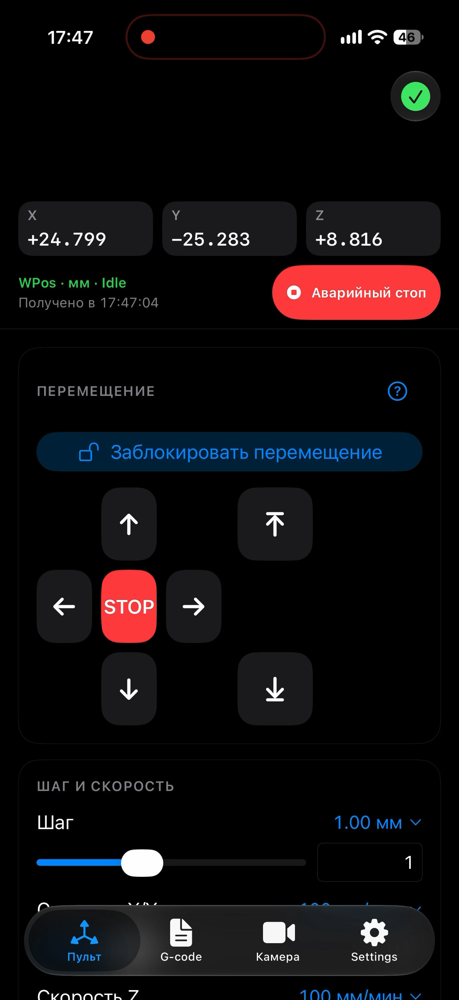
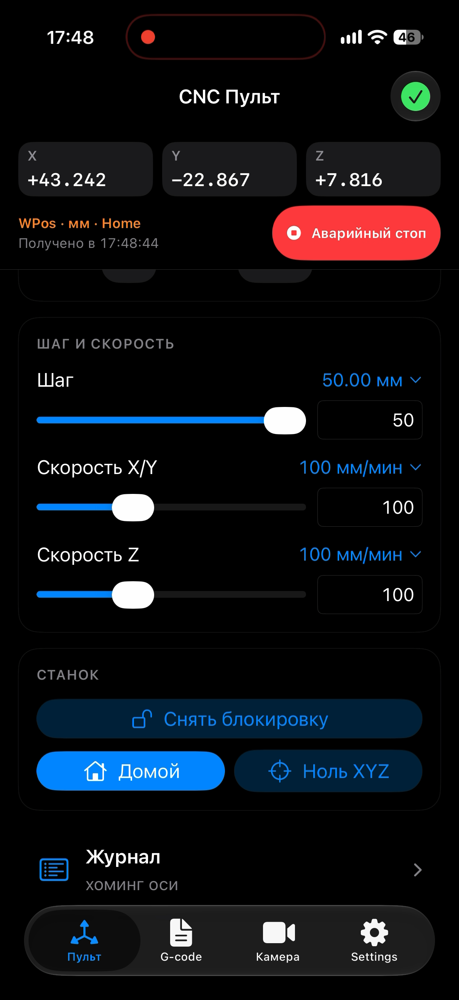
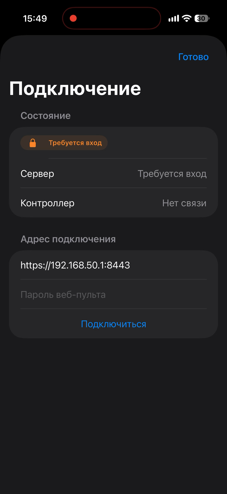
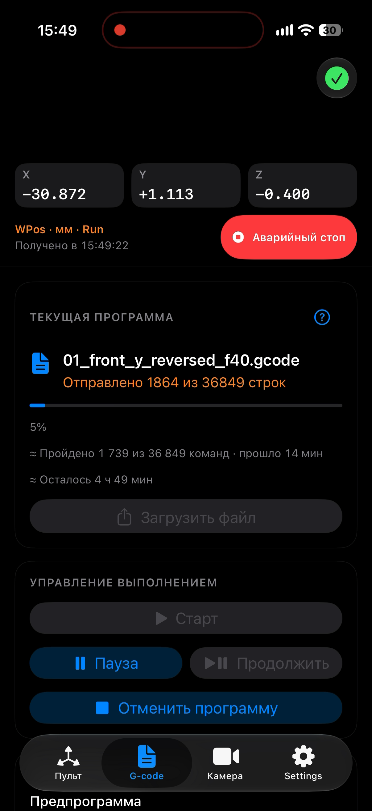
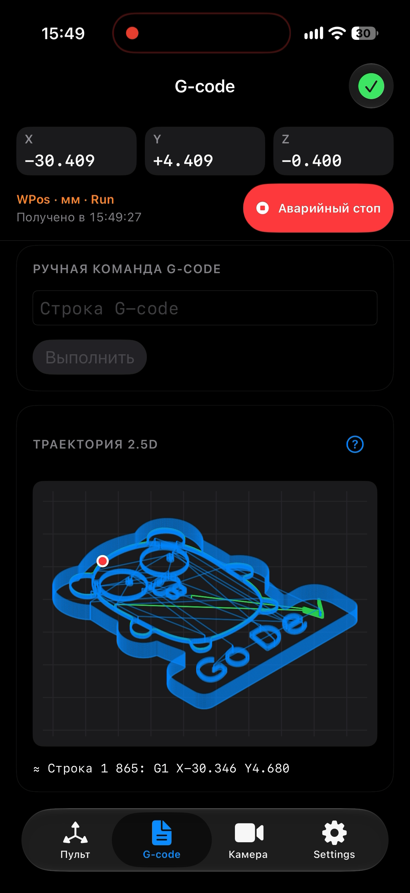
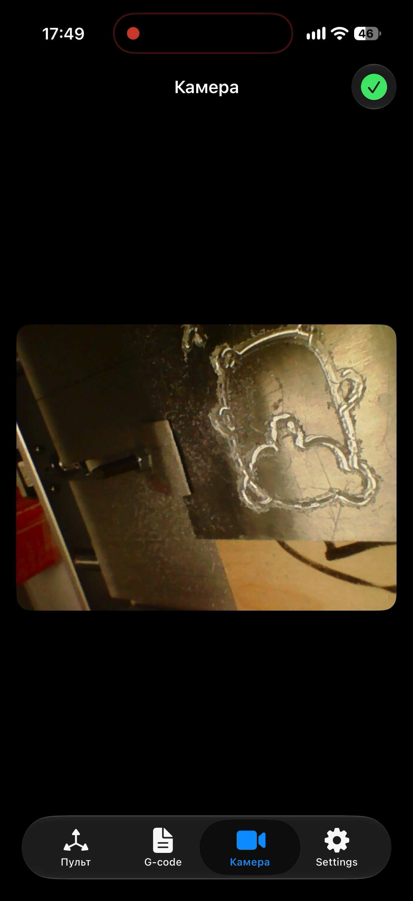
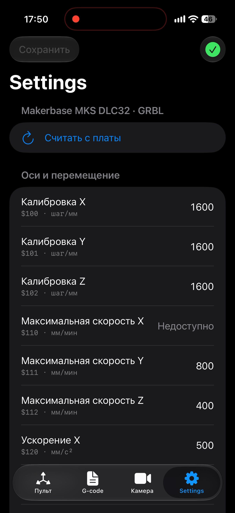
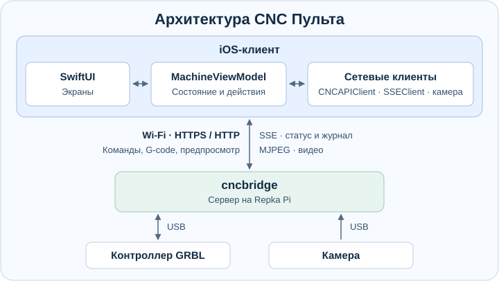

# CNC Пульт для iOS

Приложение на SwiftUI для управления ЧПУ-станком по Wi-Fi с iPhone или iPad. В пульте можно перемещать инструмент вручную, следить за координатами и видео с камеры, загружать G-code, просматривать траекторию 2.5D и управлять выполнением программы.

## Скриншоты

**Пульт и подключение**

<p>
  <a href="demo/screenshots/main1.PNG"></a>
  <a href="demo/screenshots/main2.PNG"></a>
  <a href="demo/screenshots/connect.PNG"></a>
</p>

**Выполнение G-code и траектория 2.5D**

<p>
  <a href="demo/screenshots/gcode1.PNG"></a>
  <a href="demo/screenshots/gcode2.PNG"></a>
</p>

**Камера и настройки контроллера**

<p>
  <a href="demo/screenshots/cam.PNG"></a>
  <a href="demo/screenshots/settings.PNG"></a>
</p>

## Быстрый запуск

### Запуск на iPhone или iPad

Нужны Mac с Xcode 16 или новее и устройство с iOS или iPadOS 17 или новее.

1. Откройте `cncapp.xcodeproj` в Xcode.
2. В **Signing & Capabilities** выберите команду разработчика в поле **Team**. Подключите iPhone или iPad к Mac и выберите устройство для схемы `cncapp`.
3. Запустите проект через **Product → Run**. При первом запросе разрешите доступ к локальной сети.

### Подключение по Wi-Fi

1. Подключитесь к сети `REPKA_CNC_WEB`. Для HTTPS установите сертификат `repka-web-ca.cer` с Repka и включите к нему полное доверие. [Инструкция Apple](https://support.apple.com/en-ca/102390)
2. В меню подключения укажите `https://192.168.50.1:8443`, введите пароль веб-пульта Repka и нажмите **Подключиться**.

Для сервера с HTTP укажите его адрес, например `http://repka.local:8080`. Если `cncbridge` запущен на Mac для демо, в симуляторе можно указать `http://127.0.0.1:8080`.

- Во вкладке **Камера** видео с настроенной USB-камеры доступно и при отключённом контроллере GRBL. Поток останавливается при выходе из вкладки или сворачивании приложения.
- Во вкладке **Settings** можно изменить настройки Makerbase MKS DLC32. Нажмите **Сохранить**, проверьте изменения и нажмите **Подтвердить и записать**. Нужен `cncbridge` с поддержкой `/api/controller/settings`.
- Во вкладке **G-code** можно выполнить одну строку вручную и сохранить команды, которые выполняются до и после основного файла. Для этих функций нужны `/api/gcode` и `/api/program/blocks`. При ошибке или отмене оставшиеся команды пропускаются. [Пример G-code](demo/preview.gcode)

## Архитектура



Клиент получает статус и журнал через `GET /api/events`, а видео — через `GET /api/camera/stream`. [Спецификация OpenAPI](https://github.com/andrey1af/cnc_machine/blob/main/api/openapi.yaml)

## Разработка и тесты

Из корня проекта запустите тесты правил загрузки, запуска и переподключения, декодирования ответов сервера и сборки кадров JPEG. Сервер и станок для тестов не нужны.

```sh
swift test
```

Если выбраны только Command Line Tools, укажите путь к полному Xcode.

```sh
DEVELOPER_DIR=/Applications/Xcode.app/Contents/Developer swift test
```

Соберите клиент для iOS Simulator без подписи.

```sh
DEVELOPER_DIR=/Applications/Xcode.app/Contents/Developer \
  xcodebuild -project cncapp.xcodeproj -scheme cncapp \
  -destination 'generic/platform=iOS Simulator' \
  -derivedDataPath build CODE_SIGNING_ALLOWED=NO build
```

## Вклад участников

**Лафуткин Андрей — спецификация приложения и интерфейс.** 
- Проектирование пользовательских сценариев ручного управления и наблюдения за станком. Разработка экранов «Пульт», «Подключение» и «Камера» на SwiftUI.

**Борыш Андрей — спецификация API и связь со станком.**
- Описание запросов и ответов в OpenAPI. Реализация HTTP-клиента, получения статуса и журнала по SSE, видеопотока и переподключения.

**Матюхин Георгий — G-code и тестирование.**
- Разработка загрузки программ, предпросмотра траектории 2.5D и управления выполнением. подготовка, демонстрационного файла G-code и инструкции по запуску.
